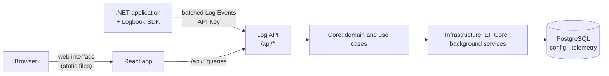

# Architecture

Logbook is a single ASP.NET Core application backed by one PostgreSQL database, a React web interface it serves, and a set of SDK packages that applications use to send their logs. This page explains how it is put together and why. It is useful background for operators and the starting point for contributors.

## The big picture



One process serves everything: the log API that applications send to, the query API, and the web interface. Background services in the same process write buffered Log Events in batches and will drop expired data.

## The server: three projects

```
Logbook.Api  →  Logbook.Core  ←  Logbook.Infrastructure
```

**Logbook.Core** knows nothing about HTTP or databases. It contains:

- the **domain**: entities such as Application and API Key, created through factory methods and changed through methods that enforce their rules, so an invalid object cannot exist.
- the **use cases**: one service class per action, each with a single `ExecuteAsync` method and its own request and response types.
- **abstractions** for what it needs from the outside, e.g. repositories.

**Logbook.Infrastructure** implements those abstractions with Entity Framework Core and PostgreSQL and runs the background services.

**Logbook.Api** is the thin outer layer: controllers that translate HTTP into calls to Core services, error handling, health checks and the wiring in `Program.cs`.

## Applications and API Keys

An Application is a program that sends its logs to Logbook. It authenticates with an API Key, and can have several at once, so a key can be replaced without losing logs: issue a new one, update the program, revoke the old one.

An API Key is a 256-bit random value. Logbook shows it once when it is issued and stores only its SHA-256 hash, so a leaked database does not reveal any usable key. A fast hash is enough here, unlike for passwords, because a random value of that size cannot be guessed. The first API Key of an Application and any key issued without an expiry stay valid until they are revoked: an expired key would make an application silently lose its logs, because the SDK drops what it cannot send rather than disturb the application.

## Signing in

People sign in, either as the local administrator or through an OpenID Connect provider, and everyone who does has full access. There are no roles, because Logbook's job is simple enough that one level of access covers it, and roles can come when there is a need. Logbook refuses to start if nobody could sign in, so an unprotected admin API cannot happen by accident. Sessions and API Keys are separate in both directions: an API Key can never manage Logbook or read logs, and a session cannot send Log Events.

The local administrator exists in the configuration, not in the database. That makes the first start safe, as there is no moment when whoever comes first creates the account, and it is the same kind of secret as the password of the database, next to it. The cost is that changing the password takes a restart. With OpenID Connect, a claim decides who gets access, and setting one is required, because a provider's job is to say who someone is, and many let anyone register.

A session is a cookie, encrypted and signed with keys from the database, so it works on every server and survives a restart. The cookie is out of reach for scripts on the page, which matters because anyone with an API Key can decide what Log Events contain. To reach it, an attacker would have to make the browser send a request from another site, which `SameSite=Strict` prevents, and for a neighbor on the same domain, the required header `X-Requested-With` does. A session lasts a fixed time rather than extending with use, because the web interface polls the health of the server, so an open tab would stay signed in forever. For the same reason a live tail ends when its session does, as it was only authorized once, when it started. The session holds no state on the server, so signing out removes the cookie from the browser but cannot revoke a copy. That is the price for needing no database lookup on each request, and it is bounded by the lifetime.

Monitoring tools cannot sign in, and need less than a person. They have a key of their own, which opens the detailed health report and nothing else.

## Running in production

Secure settings are not left to a checklist where a mistake is easy to make and hard to notice. In `Production`, which is what an image runs in unless told otherwise, Logbook [refuses to start](../reference/configuration.md#production-checks) if it would serve other hosts over plain HTTP, or still has a setting meant for development. Every response carries security headers, most importantly a content security policy that allows only scripts from Logbook itself, as a second line of defense behind rendering Log Events as text.

Logbook does not terminate TLS by default, and a [reverse proxy](../how-to/reverse-proxy.md) does that better. For it to see the address of the client and the protocol it used, it has to trust the forwarded headers, but only from known proxies, as anyone else could claim any address and escape a rate limit.

## Receiving Log Events

An application sends its Log Events in batches to `POST /api/v1/logs`, with its API Key in the header `X-Logbook-Key`. The Application of a Log Event always comes from the API Key, never from the body, so one Application cannot write into another. The Environment does come from the body: it is a label for filtering, so a Log Event without one is kept and stored as `Unknown` rather than lost.

The API Key is checked before the body is read, so a request without a valid key costs almost nothing. The size limit is checked while reading, also after decompression, because neither a chunked request nor a small gzip body that expands to gigabytes announces its real size.

A batch is accepted or rejected as a whole, which keeps the answer to the sender simple: `202`, or an error that a retry will not fix. That only works if ordinary logs do not get rejected, so values that PostgreSQL cannot store but a log line can contain, such as the character U+0000, are replaced instead of failing the batch.

An accepted batch goes into a queue in memory, and a background service writes from it with PostgreSQL's `COPY`. Sending and writing are separated so that a burst of logs or a slow database does not slow down the applications sending them, and many small requests become one large write. The price is that `202` does not mean stored yet: if the process crashes, what is in the queue is lost. For logs this is a fair trade, and the SDK loses data in the same way when an application crashes.

The queue is limited by bytes rather than by number of Log Events, because a single Log Event can be hundreds of kilobytes. When it is full, requests get `503`, so the pressure moves back to the senders, whose SDKs retry and eventually drop the oldest events instead of Logbook running out of memory.

The queue is shared, so one Application could fill it for all the others. That is what the rate limit per API Key is for: it stops a program that sends far too often, before its request is even read. It answers `429`, which tells that one sender to slow down, whereas `503` means that Logbook as a whole is overloaded. The limit refills continuously rather than per minute, because logs are bursty: right after a burst is often when they matter most, and an application should not lose them until the next minute starts.

API Keys that are not valid have their own limit per IP address, because each one costs a lookup in the database. Guessing a 256-bit key is not realistic, so this is about load rather than security. Only failures count, so applications with a valid API Key never use it up.

What happens when a write fails depends on the cause. If the database is unavailable, the batch is kept and retried with increasing delays, because every Log Event in it is still fine. If PostgreSQL refuses the data, retrying would block all writing forever, so the batch is split until the one Log Event at fault is found, and only that one is dropped. A retry can also repeat a write that succeeded but whose confirmation was lost; the primary key recognizes those Log Events, so they are stored once.

## Searching Log Events

Searching requires a session, not an API Key. An API Key lives in an application's configuration and on servers, so it is the credential most likely to leak; if it could read logs, one leak would expose everything those logs contain.

Results are paged with a cursor, a position in the order of `Timestamp` and `Id`, rather than with page numbers. An offset would have to read and skip all earlier rows, so it gets slower with every page, and new Log Events would shift the results between requests. For the same reason there is no total count: on a table this size, counting is the expensive part.

A search reads an index backwards from the newest Log Event until the page is full. That is fast when many Log Events match, but slow when few do, and a filter that matches nothing would read the whole table. So the filters that can match few rows have their own indexes: Application, Environment, trace, and a small one for the levels from `Warning` up, which are rare but what people look for. Properties have a GIN index, which finds a value by containment. Each index slows down writing, so there is deliberately none for the lower levels or for `Category`.

Full-text search covers whole words without stemming. Stemming follows the rules of one language, while logs mix languages and identifiers, and `failed` being found by `fail` is worth less than `OrderService` being found exactly as written.

## Following Log Events

The live tail sends a Log Event once it is stored. Doing this in the log endpoint would show Log Events that might never be written, so the background writer announces each batch after it is committed. The announcement carries only Ids. Every open stream then looks these Ids up in the database with its filters.

That query per batch looks wasteful next to matching in memory, but it keeps one meaning for every filter: the full-text search in particular is PostgreSQL's, and a second implementation in C# would disagree with it in small ways. People rarely follow logs in more than a few tabs, so the cost stays small, and it does not grow with the volume of the logs, only with the number of batches and streams. Following by timestamp instead would need no announcement, but it would miss every Log Event that arrives late, and they all arrive somewhat late.

The announcement never holds up writing. Each stream has a small queue of batches, and a stream that falls behind, e.g. on a slow network, loses the oldest and is told about the gap. The queue is in memory, so a stream only hears about the server it is connected to. Logbook is one process for now, and `LISTEN`/`NOTIFY` of PostgreSQL is the way out if that changes.

A stream never ends by itself, so each one ends when the server starts to stop. Otherwise it would use up the shutdown timeout, which is the time the writer needs for what is left in its queue.

## The web interface

`src/Logbook.Web` is a React application written in TypeScript and built with Vite. When the container image is built, its output is copied into the server's `wwwroot`, so one container serves the API and the interface from the same origin: no CORS, one address to secure. Every path that is not an API route or a file returns `index.html`, so the interface handles its own routes in the browser.

The filters of the log explorer live in the URL rather than in the state of a component, so a search survives a reload and can be shared. Logs are large and arrive without end, so the list renders only the rows in view, and a live tail keeps a limited number of Log Events and renders new ones a few times per second instead of for each one.

Anyone with an API Key can decide what Log Events contain, so everything that comes from a Log Event is rendered as text, never as HTML. The session cookie is out of reach for scripts on the page, and the content security policy keeps a script that gets in anyway from sending anything to another server.

During development the Vite server runs on its own port and forwards API calls to the server, so changes appear without a rebuild.

## The SDK

The SDK packages live in `sdk/` and will be published to NuGet with version 1.0:

| Package | Purpose |
|---|---|
| `Logbook.Sdk` | The client: a bounded in-memory buffer, background batching and sending, retries. Targets `net10.0`, so applications need .NET 10 or later. |
| `Logbook.Extensions.Logging` | The `ILogger` provider. Existing code that logs through `ILogger` sends to Logbook without changes. |
| `Logbook.AspNetCore` | Request, dependency and exception tracking for ASP.NET Core applications. |

The most important rule of the SDK is that it never hurts the application it runs in. A call to `ILogger` only puts the event into the buffer and returns. Sending happens in the background; if Logbook is slow or unreachable, the SDK retries and, when the buffer is full, drops the oldest events instead of using more memory or blocking.

A batch stays in the buffer until the server has accepted it, so it counts towards the limits while it is being sent and is the first to be dropped. This is why the buffer is a queue behind a short lock and not a `Channel<T>`, from which an event is gone once it is read. The buffer is limited by memory as well as by number of events, because 10,000 events of 256 KiB would otherwise take gigabytes from the application. A batch is sent when it is full or when its oldest event has waited for the flush interval, compressed with gzip.

The server rejects a whole batch for a single event it does not accept, so the client enforces the same limits before sending. Dropping a large event would lose exactly the logs that tend to matter, such as a huge stack trace, so its long text is cut first and it is marked as truncated. Since a wrong API Key is usually fixed by someone within a while, it is treated like an outage with a long backoff rather than a reason to throw events away. The details are in [SDK behavior](../reference/sdk-behavior.md).

The `ILogger` provider writes the structured values of a call to JSON right away, on the thread of the application, because they could change while the event waits in the buffer. Objects other than plain values and collections are sent as text instead of being serialized: reflection would run their getters, could follow cycles and could send secrets nobody meant to log.

The SDK reports what it does through an `EventSource`. Logging through `ILogger` would send its own logs to itself, and every attempt to send would create more to send.

The SDK does not reference the server projects. The two only share the format of the requests, which is versioned so that older SDKs keep working with newer servers.

## Spans, transactions and exceptions

A Log Event says what an application wanted to tell, while a span says what it did and how long that took. Spans are stored in a table of their own, because they have fields a Log Event does not, and because they would otherwise flood the log explorer and its indexes. They go through the same machinery of queue, batches and partitions, with their own queue and writer, so a burst of requests cannot hold up the logs that explain it.

A **transaction** is not stored as such. It is what a Trace Id finds in both tables, put together when it is asked for. That also covers several Applications, as the Trace Id travels with their calls.

**Groups of exceptions** are not stored either. Each Log Event gets a fingerprint when it is received, and the groups are aggregated from those with a small index that only holds Log Events with an exception. A table of groups would be faster to read, but its counts would have to follow retention, deletions and every time range someone asks for, and could disagree with what is actually stored. What counts for a fingerprint is explained in [the reference](../reference/telemetry-api.md#what-makes-two-exceptions-the-same).

The SDK finds requests with a middleware, as only there the route and status are known. It finds dependencies through `ActivitySource`s, which needs no change to how an application creates its clients. Its own requests must not be tracked, or each one would create another to send. Comparing addresses would also hide calls of the application to the same server, so the loop that sends marks its own asynchronous flow instead.

## The database

PostgreSQL holds all state, in two schemas:

| Schema | Content |
|---|---|
| `config` | Applications with their retention, API Key hashes, the keys of the sessions, saved searches and, later, alert rules. Small, kept, backed up. |
| `telemetry` | Log Events, spans (requests and dependencies) and metric points. Large, written constantly, expires. |

The split follows how the data is used. Log Events are stored in tables **partitioned by day** in UTC, so retention can drop whole partitions instead of deleting rows, which is fast and leaves no bloat. Their properties are stored as `jsonb` with a GIN index, so you can search by any property your application logs.

Deleting an Application deletes its Log Events, spans and metric points, because logs can contain personal data, and "delete" should mean it. They have no foreign key to their Application: a cascade would delete them all in one long transaction, and the key would be checked for every inserted row. Instead, the Application goes first, so its API Keys stop working, and then its Log Events go in small steps, so an interrupted request keeps its progress and repeating it finishes the job. Log Events still in the queue cannot slip through: each write first locks the Applications it writes for and discards Log Events whose Application is gone, while a deletion waits for writes in progress and then removes their rows too.

Logbook never changes its schema at startup. Migrations are a separate, explicit step (the `migrator` container image or `dotnet ef database update`), so a deployment never alters the database by accident and the application user needs no rights to change the schema.

Partitions are the one thing that has to appear while Logbook runs, because new days keep coming. A database function created by the migrations makes the partition for a day when the first Log Event of that day arrives. It runs with the rights of the user that applied the migrations, so the application user only needs to be allowed to call it. The application user does need `USAGE` on the schema `telemetry` and `SELECT`, `INSERT` and `DELETE` on `telemetry.log_events`, `telemetry.spans` and `telemetry.metrics`. Only days inside the accepted time window of a Log Event get a partition, so a sender cannot create an unlimited number of tables. The application user also needs `SELECT` and `INSERT` on `config.data_protection_keys`, and `SELECT`, `INSERT`, `UPDATE` and `DELETE` on `config.saved_searches`.

Retention has to deal with a mismatch: a partition holds one day of all Applications, while each Application has its own retention. A background service therefore does two things. It drops the partitions that have expired for every Application, using another such function, one at a time and giving up quickly if a long search holds the table, because everything else would queue up behind a waiting `DROP`. Then it deletes the rest row by row in small steps, for Applications with a shorter retention than the longest one. Every drop and every step reads the retention again and holds it until it is done, as logs that an administrator just decided to keep must not be lost to a run that started earlier, and a change of the retention only waits for that moment. So what you pay for depends on your settings: if all Applications keep logs equally long, retention costs almost nothing, whereas one with a much shorter retention than the others costs deletes and vacuuming. The Application with the longest retention keeps Log Events until their whole day has expired, up to a day longer, which saves it those deletes.

## Dashboards and metrics

The overview and the charts are computed from the stored rows when they are asked for, with `date_bin` into buckets of a fixed list of widths, rather than kept as running totals. So they cannot disagree with what can be searched, retention and deleting an Application need no extra work, and any time range and filter can be asked for. The cost is a scan of the rows in the range, which the partitioning by day and the indexes on time keep to the days asked for.

Custom metrics are aggregated in the application before they are sent, as Application Insights does with `GetMetric`: one metric point per metric, set of dimensions and minute, with count, sum, minimum and maximum. The volume then depends on how many series an application has, not on how often it measures, and those four values can be combined again into any longer bucket. Percentiles cannot be combined that way, so metrics have none; the durations of requests, which are stored one by one, do.
