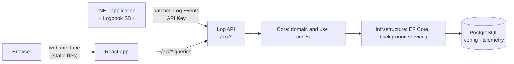

# Architecture

Logbook is a single ASP.NET Core application backed by one PostgreSQL database, a React web interface it serves, and a set of SDK packages that applications use to send their logs. This page explains how it is put together and why. It is useful background for operators and the starting point for contributors.

## The big picture



One process serves everything: the log API that applications send to, the query API, and the web interface. Background services in the same process write buffered Log Events in batches and will drop expired data.

## The server: three projects

```
Logbook.Api  →  Logbook.Core  ←  Logbook.Infrastructure
```

**Logbook.Core** knows nothing about HTTP or databases. It contains:

- the **domain**: entities such as Application and API Key, created through factory methods and changed through methods that enforce their rules, so an invalid object cannot exist.
- the **use cases**: one service class per action, each with a single `ExecuteAsync` method and its own request and response types.
- **abstractions** for what it needs from the outside, e.g. repositories.

**Logbook.Infrastructure** implements those abstractions with Entity Framework Core and PostgreSQL and runs the background services.

**Logbook.Api** is the thin outer layer: controllers that translate HTTP into calls to Core services, error handling, health checks and the wiring in `Program.cs`.

## Applications and API Keys

An Application is a program that sends its logs to Logbook. It authenticates with an API Key, and can have several at once, so a key can be replaced without losing logs: issue a new one, update the program, revoke the old one.

An API Key is a 256-bit random value. Logbook shows it once when it is issued and stores only its SHA-256 hash, so a leaked database does not reveal any usable key. A fast hash is enough here, unlike for passwords, because a random value of that size cannot be guessed. The first API Key of an Application and any key issued without an expiry stay valid until they are revoked: an expired key would make an application silently lose its logs, because the SDK drops what it cannot send rather than disturb the application.

The admin API that manages them is protected by a single key from the configuration, sent as a Bearer token. It is deliberately simple, because it only has to hold until sign-in arrives in milestone M4. Logbook refuses to start without it, so an unprotected admin API cannot happen by accident. The key is separate from API Keys in both directions: an API Key can never manage Logbook.

## Receiving Log Events

An application sends its Log Events in batches to `POST /api/v1/logs`, with its API Key in the header `X-Logbook-Key`. The Application of a Log Event always comes from the API Key, never from the body, so one Application cannot write into another. The Environment does come from the body: it is a label for filtering, so a Log Event without one is kept and stored as `Unknown` rather than lost.

The API Key is checked before the body is read, so a request without a valid key costs almost nothing. The size limit is checked while reading, also after decompression, because neither a chunked request nor a small gzip body that expands to gigabytes announces its real size.

A batch is accepted or rejected as a whole, which keeps the answer to the sender simple: `202`, or an error that a retry will not fix. That only works if ordinary logs do not get rejected, so values that PostgreSQL cannot store but a log line can contain, such as the character U+0000, are replaced instead of failing the batch.

An accepted batch goes into a queue in memory, and a background service writes from it with PostgreSQL's `COPY`. Sending and writing are separated so that a burst of logs or a slow database does not slow down the applications sending them, and many small requests become one large write. The price is that `202` does not mean stored yet: if the process crashes, what is in the queue is lost. For logs this is a fair trade, and the SDK loses data in the same way when an application crashes.

The queue is limited by bytes rather than by number of Log Events, because a single Log Event can be hundreds of kilobytes. When it is full, requests get `503`, so the pressure moves back to the senders, whose SDKs retry and eventually drop the oldest events instead of Logbook running out of memory.

What happens when a write fails depends on the cause. If the database is unavailable, the batch is kept and retried with increasing delays, because every Log Event in it is still fine. If PostgreSQL refuses the data, retrying would block all writing forever, so the batch is split until the one Log Event at fault is found, and only that one is dropped. A retry can also repeat a write that succeeded but whose confirmation was lost; the primary key recognizes those Log Events, so they are stored once.

## The web interface

`src/Logbook.Web` is a React application written in TypeScript and built with Vite. When the container image is built, its output is copied into the server's `wwwroot`, so one container serves the API and the interface from the same origin: no CORS, one address to secure. Every path that is not an API route or a file returns `index.html`, so the interface handles its own routes in the browser.

During development the Vite server runs on its own port and forwards API calls to the server, so changes appear without a rebuild.

## The SDK

The SDK packages live in `sdk/` and are published to NuGet:

| Package | Purpose |
|---|---|
| `Logbook.Sdk` | The client: a bounded in-memory buffer, background batching and sending, retries. Targets `netstandard2.0` and `net10.0`, so older applications can use it too. |
| `Logbook.Extensions.Logging` | The `ILogger` provider. Existing code that logs through `ILogger` sends to Logbook without changes. |
| `Logbook.AspNetCore` | Request, dependency and exception tracking for ASP.NET Core applications. |

The most important rule of the SDK is that it never hurts the application it runs in. A call to `ILogger` only puts the event into the buffer and returns. Sending happens in the background; if Logbook is slow or unreachable, the SDK retries and, when the buffer is full, drops the oldest events instead of using more memory or blocking.

The SDK does not reference the server projects. The two only share the format of the requests, which is versioned so that older SDKs keep working with newer servers.

## The database

PostgreSQL holds all state, in two schemas:

| Schema | Content |
|---|---|
| `config` | Applications, API Key hashes, retention settings and, later, alert rules. Small, kept, backed up. |
| `telemetry` | Log Events and, later, requests and dependencies. Large, written constantly, expires. |

The split follows how the data is used. Log Events are stored in tables **partitioned by day** in UTC, so retention drops whole partitions instead of deleting rows, which is fast and leaves no bloat. Their properties are stored as `jsonb` with a GIN index, so you can search by any property your application logs.

Log Events have no foreign key to their Application. It would be checked for every inserted row, and deleting an Application would have to search every partition. So deleting an Application leaves its Log Events in place, until retention (milestone M4) removes them.

Logbook never changes its schema at startup. Migrations are a separate, explicit step (the `migrator` container image or `dotnet ef database update`), so a deployment never alters the database by accident and the application user needs no rights to change the schema.

Partitions are the one thing that has to appear while Logbook runs, because new days keep coming. A database function created by the migrations makes the partition for a day when the first Log Event of that day arrives. It runs with the rights of the user that applied the migrations, so the application user only needs to be allowed to call it. The application user does need `USAGE` on the schema `telemetry` and `SELECT` and `INSERT` on `telemetry.log_events`. Only days inside the accepted time window of a Log Event get a partition, so a sender cannot create an unlimited number of tables.
