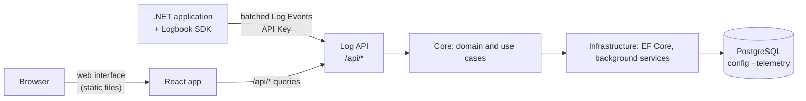

# Architecture

Logbook is a single ASP.NET Core application backed by one PostgreSQL database, a React web interface it serves, and a set of SDK packages that applications use to send their logs. This page explains how it is put together and why. It is useful background for operators and the starting point for contributors.

## The big picture



One process serves everything: the log API that applications send to, the query API, and the web interface. Background services in the same process will write buffered Log Events in batches and drop expired data.

## The server: three projects

```
Logbook.Api  →  Logbook.Core  ←  Logbook.Infrastructure
```

**Logbook.Core** knows nothing about HTTP or databases. It contains:

- the **domain**: entities such as Application and API Key, created through factory methods and changed through methods that enforce their rules, so an invalid object cannot exist.
- the **use cases**: one service class per action, each with a single `ExecuteAsync` method and its own request and response types.
- **abstractions** for what it needs from the outside, e.g. repositories.

**Logbook.Infrastructure** implements those abstractions with Entity Framework Core and PostgreSQL and runs the background services.

**Logbook.Api** is the thin outer layer: controllers that translate HTTP into calls to Core services, error handling, health checks and the wiring in `Program.cs`.

## The web interface

`src/Logbook.Web` is a React application written in TypeScript and built with Vite. When the container image is built, its output is copied into the server's `wwwroot`, so one container serves the API and the interface from the same origin: no CORS, one address to secure. Every path that is not an API route or a file returns `index.html`, so the interface handles its own routes in the browser.

During development the Vite server runs on its own port and forwards API calls to the server, so changes appear without a rebuild.

## The SDK

The SDK packages live in `sdk/` and are published to NuGet:

| Package | Purpose |
|---|---|
| `Logbook.Sdk` | The client: a bounded in-memory buffer, background batching and sending, retries. Targets `netstandard2.0` and `net10.0`, so older applications can use it too. |
| `Logbook.Extensions.Logging` | The `ILogger` provider. Existing code that logs through `ILogger` sends to Logbook without changes. |
| `Logbook.AspNetCore` | Request, dependency and exception tracking for ASP.NET Core applications. |

The most important rule of the SDK is that it never hurts the application it runs in. A call to `ILogger` only puts the event into the buffer and returns. Sending happens in the background; if Logbook is slow or unreachable, the SDK retries and, when the buffer is full, drops the oldest events instead of using more memory or blocking.

The SDK does not reference the server projects. The two only share the format of the requests, which is versioned so that older SDKs keep working with newer servers.

## The database

PostgreSQL holds all state, in two schemas:

| Schema | Content |
|---|---|
| `config` | Applications, API Key hashes, retention settings and, later, alert rules. Small, kept, backed up. |
| `telemetry` | Log Events and, later, requests and dependencies. Large, written constantly, expires. |

The split follows how the data is used. Log Events are stored in tables **partitioned by day**, so retention drops whole partitions instead of deleting rows, which is fast and leaves no bloat. Their properties are stored as `jsonb` with a GIN index, so you can search by any property your application logs.

Logbook never changes its schema at startup. Migrations are a separate, explicit step (the `migrator` container image or `dotnet ef database update`), so a deployment never alters the database by accident and the application user needs no rights to change the schema.
